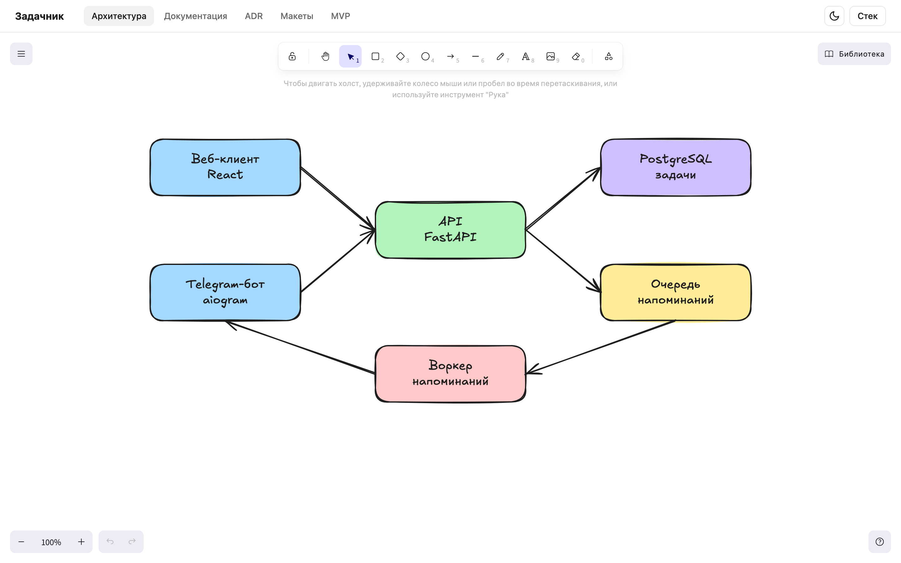
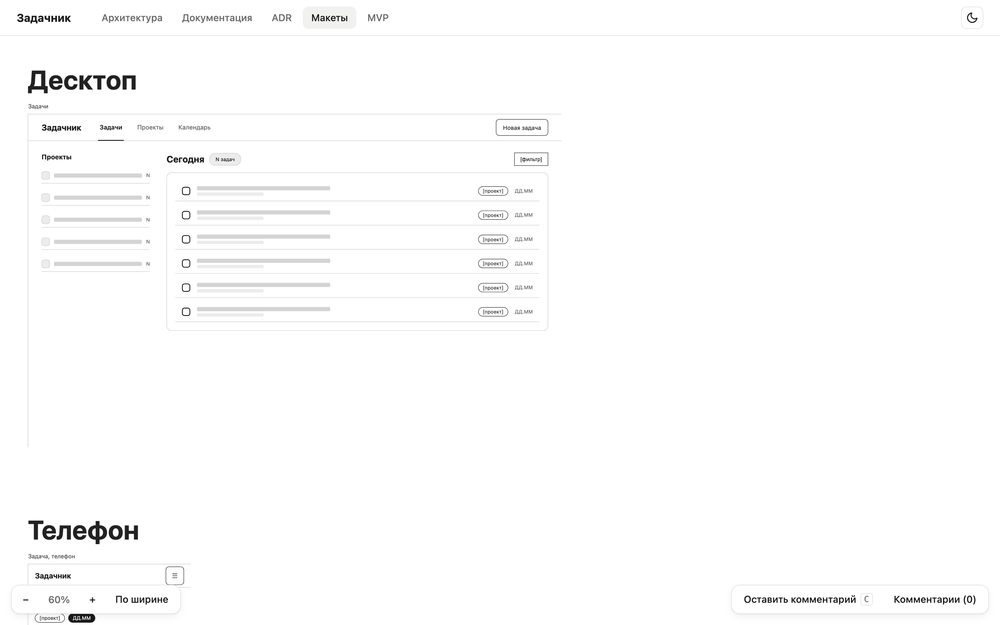
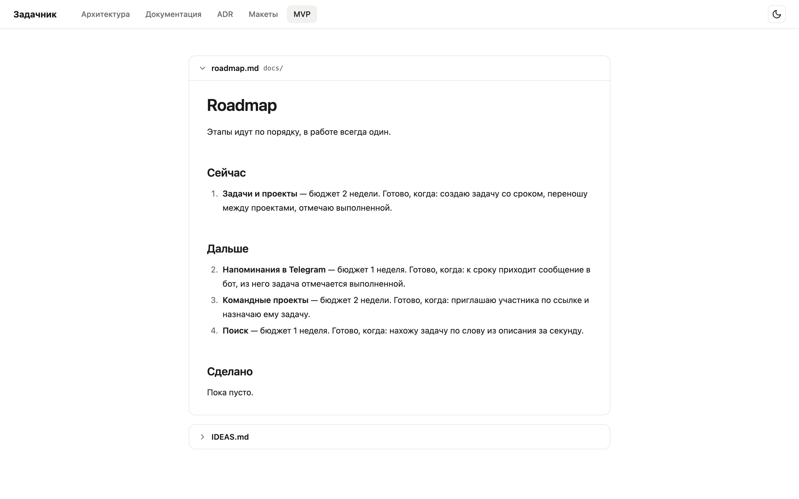

<p align="center">
  
</p>

<h1 align="center">blueprint</h1>

<p align="center">
  Локальная страница проекта: схема архитектуры, документация, ADR, каркасы экранов и roadmap в одном окне.<br>
  Ставится одной командой в любой репозиторий и показывает его собственные файлы, поэтому синхронизировать нечего.
</p>

<p align="center">
  
  
  
  <a href="LICENSE"></a>
</p>

<p align="center">
  
</p>

## Возможности

- Схема архитектуры в Excalidraw на весь экран. Блоки двигаются и правятся мышью, а изменения сами сохраняются в `docs/architecture.excalidraw` проекта, так что схема живёт в git рядом с кодом и её видно в диффе.
- Документы к схеме открываются кнопкой в шапке боковой панелью поверх холста, например `docs/stack.md`. Подпись кнопки задаётся в конфиге, `Esc` закрывает панель.
- Доска каркасов экранов. Все экраны из папки макетов выложены на одну страницу по группам (десктоп, телефон). Доска двигается пробелом с мышью, как в Figma, и масштабируется колесом с Ctrl или ⌘; масштаб можно ввести числом в панели снизу, `Shift+0` возвращает 100%. Режим «Оставить комментарий» превращает щелчок по любому элементу в заметку с номерной точкой, а все заметки видны в панели справа и сохраняются в `FEEDBACK.md` рядом с макетами. Перед каждой записью файл перечитывается, так что отметки `[x]`, поставленные агентом, не затираются.
- Документация проекта деревом: папка из конфига слева, документ справа, схемы mermaid рисуются. Ссылки на `.md` из любой вкладки, включая roadmap и панель схемы, открывают документ во вкладке, которая его показывает, якоря прокручивают к разделу. HTML из markdown проходит через DOMPurify, так что чужой документ не выполнит скрипт.
- Список ADR с номером, названием и статусом из заголовка каждого решения.
- Roadmap и инбокс идей из markdown. Документ можно сделать выпадающим блоком, раскрытым или свёрнутым по умолчанию: roadmap открыт, идеи под спойлером.
- Вкладки и файлы задаются одним `blueprint.json`. Страница не хранит своих данных, она показывает файлы проекта, поэтому правка в редакторе и правка на странице это одна и та же правка.
- Светлая и тёмная тема по системе с переключателем, скелетоны при загрузке без сдвигов шапки.
- Ни npm, ни сборки: сервер на стандартной библиотеке Python, браузер берёт библиотеки с `esm.sh` по зафиксированным версиям и только там, где они нужны: React и Excalidraw грузятся на вкладке схемы, mermaid только в документе со схемой.

<p align="center">
  
  &nbsp;&nbsp;
  
</p>

## Установка

Нужен Python 3.9 или новее и браузер с доступом к `esm.sh`.

```bash
git clone https://github.com/semyonsurkov/blueprint.git
cd blueprint
./install.sh
```

`install.sh` кладёт симлинк `blueprint` в `~/.local/bin`, поэтому `git pull` в репозитории сразу обновляет и команду. Каталог `~/.local/bin` должен быть в `PATH`. На Windows скрипта нет: команды запускаются как `python путь\к\blueprint\bin\blueprint init`, сервер там стартует дочерним процессом.

## Быстрый старт

```bash
cd ~/projects/my-app
blueprint init
blueprint
```

`init` ищет в проекте документацию (`docs/`, `documents/`, `wiki/` и подобные на глубине до четырёх уровней, так что находится и `apps/web/docs` в монорепо), схемы `.excalidraw`, папки ADR, roadmap и идеи, пропуская скрытые каталоги, `node_modules`, `vendor` и сборочные папки. Потом он спрашивает пути с подставленным найденным и печатает, что получилось:

```text
создан blueprint/blueprint.json
  Архитектура: architecture.excalidraw (есть)
  Документация: apps/web/docs (74 .md)
  ADR: apps/web/docs/adr (12 .md)
  MVP: ROADMAP.md (есть)
макеты экранов не заведены; добавить: blueprint init --reconfigure --mockups design/mockups
запуск: blueprint, адрес http://localhost:5523
```

Чего нет в проекте, того нет и среди вкладок: страница без документации не показывает пустую «Документацию». Схема архитектуры есть всегда, файл создаётся при первом сохранении. Макеты экранов ставятся только по ответу «да» или флагу `--mockups`, бэкенду без интерфейса они не нужны.

Порт выбирается из пути к проекту и записывается в конфиг, поэтому у каждого проекта свой адрес, страницы двух проектов открываются одновременно и не делят тему и состояние дерева.

Страница коммитится вместе с проектом, поэтому у того, у кого CLI нет, она запускается напрямую: `python3 blueprint/serve.py`.

## Для агента

Агенту, который ставит blueprint в проект, достаточно четырёх шагов, вопросов команды не задают:

1. Поставить CLI: `git clone` и `./install.sh`, как выше, либо вызывать `python3 <путь>/bin/blueprint`.
2. В корне проекта выполнить `blueprint init --json`, при необходимости с флагами путей. Вывод это JSON с портом, списком вкладок (у каждой источник и пометка, есть ли файл), другими подходящими папками в `alternatives` и предупреждениями. Повторный вызов на установленном проекте возвращает `"installed": true` и обновляет код страницы.
3. Если в проекте есть экраны, добавить макеты: `blueprint init --reconfigure --json --mockups design/mockups`, затем в корневой `AGENTS.md` проекта строку «каркасы экранов: правила в `design/mockups/AGENTS.md`».
4. Запустить `blueprint` и открыть адрес из вывода. Если страница пишет, что библиотеки не загрузились с `esm.sh`, выполнить `blueprint vendor` на машине с доступом к интернету.

Каждая ошибка CLI это одна строка с причиной и следующей командой, трассировок нет. После `blueprint update` команда сама перечисляет устаревшие файлы в папке макетов, если проект ставился старой версией.

## Команды

| Команда | Что делает |
|---|---|
| `blueprint init` | ставит страницу в `./blueprint/` и собирает конфиг под раскладку проекта; повторный запуск обновляет код страницы и конфиг не трогает |
| `blueprint init --yes` или `--json` | то же без вопросов, по найденному и флагам; `--json` печатает отчёт для агента |
| `blueprint init --docs … --exclude … --architecture … --mockups … --roadmap … --ideas … --adr …` | пути вручную; `нет` вместо пути убирает пункт, `.` означает корень проекта |
| `blueprint init --reconfigure` | пересобирает `blueprint.json`, прежний сохраняется в `blueprint.json.bak`; прежние пути, порт и вкладки, добавленные руками, переносятся, флаги меняют только названное |
| `blueprint init --here` | ставит в подпапку, даже если выше уже есть blueprint: для отдельного проекта внутри монорепо |
| `blueprint update` | обновляет код страницы до версии из репозитория; конфиг и файлы макетов не трогает |
| `blueprint` или `blueprint serve` | запускает сервер, ищет `blueprint/` вверх от текущей папки |
| `blueprint new-screen OrderDetail --title "Заказ" --about "…"` | создаёт файл экрана и запись в `screens.json`; `--group` и `--size 1280x800` необязательны |
| `blueprint check` | проверяет макеты и выводит проблемы с путём от корня проекта и строкой; код возврата 1, если что-то нашлось |
| `blueprint vendor` | скачивает библиотеки в `blueprint/vendor/`, чтобы страница работала без `esm.sh`; `--remove` возвращает к CDN |

## blueprint.json

```json
{
  "title": "Мой проект",
  "port": 5523,
  "tabs": [
    { "id": "architecture", "title": "Архитектура", "type": "excalidraw",
      "file": "docs/architecture.excalidraw", "docs": ["docs/stack.md"], "docs_label": "Стек" },
    { "id": "docs", "title": "Документация", "type": "docs", "dir": "docs", "exclude": ["archive"] },
    { "id": "adr", "title": "ADR", "type": "adr", "dir": "docs/adr" },
    { "id": "mockups", "title": "Макеты", "type": "frame", "src": "design/mockups/index.html" },
    { "id": "mvp", "title": "MVP", "type": "markdown",
      "docs": [{ "path": "docs/roadmap.md", "collapsed": false }, { "path": "IDEAS.md", "collapsed": true }] }
  ]
}
```

| Поле | Смысл |
|---|---|
| `title` | заголовок страницы и вкладки браузера |
| `port` | порт сервера; `init` выбирает его из пути к проекту |
| `tabs[].id`, `tabs[].title` | якорь в адресе и подпись вкладки |
| `type: "excalidraw"` | `file` это схема, `docs` открываются кнопкой в шапке, `docs_label` её подпись (по умолчанию «Документы») |
| `type: "frame"` | `src` открывается во встроенном окне, в его документ передаётся `data-theme="dark"` или `"light"`; у заготовки макетов тёмная тема уже есть в `wire.css` |
| `type: "markdown"` | `docs` идут подряд на странице |
| `type: "docs"` | `dir` показывается деревом markdown-файлов, `exclude` перечисляет подпапки, которые не показывать; первым открывается `README.md` папки, адрес документа сохраняется в ссылке |
| `type: "adr"` | `dir` показывается списком решений: название из заголовка `#`, статус из строки «Статус:» или `status:` |
| элемент `docs` | строка с путём или `{ "path", "collapsed" }`: `true` свёрнутый блок, `false` раскрытый, без поля обычный документ |

Все пути считаются от корня проекта. Ошибку в конфиге, например битый JSON или пустой список вкладок, страница показывает текстом вместо пустого экрана.

## Макеты

В проекте лежат только файлы, которыми владеет проект. Код доски, комментариев, разворачивания повторов и иконок живёт в `blueprint/` и обновляется через `blueprint update`:

```
design/mockups/
  index.html      заготовка доски на несколько строк, сама доска в blueprint/board.js
  wire.css        токены, утилиты и компоненты экранов, светлая и тёмная тема
  wire.js         шапки и другие общие блоки проекта, передаются в renderScreens
  screens.json    подписи общих блоков и манифест: файл, название, группа, размер, описание
  AGENTS.md       правила для агента
  FEEDBACK.md     комментарии к экранам, появляется после первого комментария
  <Экран>.html    один файл на экран, только разметка на классах
```

Нейронка открывает `screens.json`, находит экран по описанию и правит один файл в несколько килобайт. Повторяющиеся блоки записаны один раз с `data-repeat`, шапка вставляется из `wire.js`, цвета и радиусы живут переменными в `wire.css`, поэтому правка общего вида делается в одном месте.

`blueprint check` проверяет то, что иначе держится на внимательности: каждый экран записан в `screens.json` и наоборот, все классы есть в `wire.css`, в `style` только размеры и позиция, блоки `data-wire` объявлены в `wire.js`, `data-repeat` больше единицы, пункты `FEEDBACK.md` в нужном формате. Проверка без зависимостей и занимает доли секунды, её можно запускать после каждой правки.

`AGENTS.md` в папке макетов короткий: найти экран в манифесте, создать новый через `new-screen`, править классами, закончить, когда `check` чист. Так макеты уверенно правит и слабая модель: ошибки она видит в выводе проверки и исправляет по подсказке.

На доске экраны вставлены прямо в страницу, без iframe, поэтому комментарии работают на всех экранах сразу. Комментарий хранит путь к элементу от `.screen` экрана, по нему точка встаёт на место после перезагрузки, а модель находит место в файле. Название над превью открывает экран отдельно, комментарии работают и там.

## Безопасность

Сервер слушает только `127.0.0.1`, запросы с чужим `Host` отклоняются (защита от DNS rebinding), запись принимается только с `Origin` этого же сервера. Файлы и папки, имя которых начинается с точки (`.git`, `.env`, `.npmrc`, `.ssh`), не отдаются ни в каком регистре и кодировании пути, листинги каталогов закрыты. Список файлов для вкладок `docs` и `adr` строится только по папкам из конфига, без скрытых каталогов, `node_modules`, `vendor` и сборочных папок и без выхода за пределы проекта.

На диск сервер пишет в двух случаях: схема из вкладки `excalidraw`, когда путь совпадает с `file` из конфига, и `FEEDBACK.md` рядом с доской макетов. Запись атомарная, через временный файл, так что сбой посреди сохранения не испортит схему; невалидная схема отклоняется с 400. HTML из markdown проходит через DOMPurify без скриптов, стилей и форм.

Библиотеки страница берёт с `esm.sh` по закреплённым версиям, без SRI, поэтому этот CDN остаётся точкой доверия: страница с правом записи исполняет его код. Для проекта, где это неприемлемо, библиотеки кладутся в проект командой `blueprint vendor`, см. раздел ниже.

## Без доступа к esm.sh

В корпоративной сети внешний CDN бывает закрыт. Тогда библиотеки кладутся в сам проект одной командой на машине, где `esm.sh` и `registry.npmjs.org` доступны:

```bash
blueprint vendor
```

Команда обходит граф модулей из `versions.json`, скачивает их в `blueprint/vendor/`, переписывает адреса в коде страницы на локальные и добавляет шрифты Excalidraw и иконки Lucide из npm-архивов. Выходит около 13 МБ: примерно 7 занимает Excalidraw, 5 mermaid одним файлом, 1 иконки. После этого страница не делает ни одного внешнего запроса. Папку можно закоммитить, тогда страница работает у всех, кто склонировал проект, или добавить в `.gitignore` и запускать `vendor` на каждой машине.

Без сети не работают две вещи: диалог «Mermaid в схему» в Excalidraw, он тянет ещё одну копию mermaid на 20 МБ и не скачивается, и китайский шрифт Xiaolai на схеме, вместо него иероглифы рисуются запасным шрифтом.

`blueprint update` сохраняет локальный режим, если версии не менялись, иначе просит запустить `vendor` заново. `blueprint vendor --remove` удаляет копию и возвращает страницу к `esm.sh`.

## Версии библиотек

Версии всех библиотек страницы записаны в одном месте, `versions.json` в корне репозитория. Адреса `esm.sh` в `page/` с ними сверяет и переписывает `scripts/deps.py`, руками версии в коде не меняются:

```bash
python3 scripts/deps.py check
python3 scripts/deps.py update
python3 scripts/deps.py update marked --major
```

`check` показывает для каждого пакета текущую версию, последнюю в той же мажорной и последнюю вообще, а также расхождения адресов в `page/` с `versions.json`. `update` без имён поднимает все пакеты в пределах мажорной версии, с именами только названные, `--major` разрешает переход на новую мажорную. Перед записью скрипт сверяет `peerDependencies` нового набора, например что `marked-gfm-heading-id` поддерживает выбранный `marked`, и что `react` и `react-dom` одной версии; при конфликте ничего не пишет и называет, кто чего требует. После обновления страницу стоит открыть в браузере, а в проекты новые версии приходят через `blueprint update`.

## Как устроено

```
bin/blueprint        CLI: init, update, serve, new-screen, check
bin/layout.py        поиск раскладки проекта и порт по пути
bin/mockups.py       проверка макетов и создание экрана
bin/vendor.py        локальная копия библиотек для работы без esm.sh
page/                код страницы, копируется в проект при init и update
  serve.py           сервер на http.server
  index.html         оболочка и importmap с версиями библиотек
  theme.js           тема до первой отрисовки, общая для страницы, доски и экранов
  blueprint.js       вкладки, маршрутизация, ошибки
  markdown.js        разметка, ссылки, якоря, mermaid; библиотеки грузятся лениво
  docs.js            дерево документации и список ADR
  schema.js          схема Excalidraw, грузится только на своей вкладке
  board.js, .css     доска макетов
  screen.js          общий код экранов: блоки, повторы, иконки
  feedback.js, .css  комментарии на макетах
  icons.js           иконки lucide для оболочки и комментариев
  ui.css             кит: токены, кнопки, поля, окна, панели
  blueprint.css      раскладка страницы
template/mockups/    заготовка папки макетов
versions.json        версии библиотек страницы, единственный источник
scripts/deps.py      проверка и обновление версий
install.sh           симлинк CLI в ~/.local/bin
```

Код страницы копируется в проект, а не подключается из глобальной установки: так страница работает у любого, кто склонировал проект, и не ломается, когда CLI обновился, а проект нет. `blueprint update` подтягивает новую версию осознанно, отдельным диффом.

## Лицензии

Код распространяется под лицензией MIT, см. [LICENSE](LICENSE).

Библиотеки не входят в репозиторий и загружаются браузером с `esm.sh` во время работы страницы. React, Excalidraw, marked, marked-gfm-heading-id, mermaid и lucide-static распространяются под MIT или ISC, DOMPurify под MPL-2.0 или Apache-2.0.
